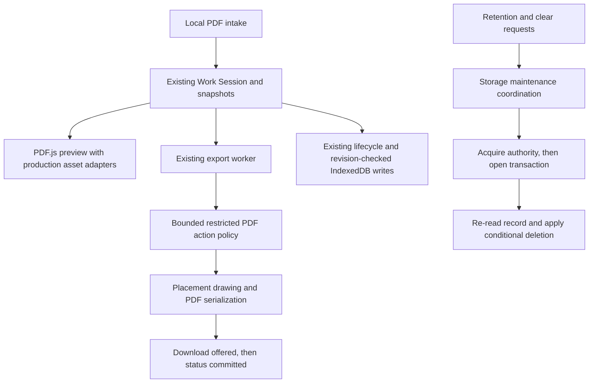

# SignLite browser-app hardening implementation plan

> Implementation handoff: use the executing-plans skill to implement this plan task by task. This document approves a direction and defines gates. It does not claim the fixes are implemented or authorize production deployment.

**Goal:** Prepare the existing browser-based SignLite web app for a controlled beta without compromising its session model, user data, or maintainability.

**Architecture:** Keep React, Zustand, PDF.js, pdf-lib, IndexedDB, the existing workers, and the static hosting model. Repair the existing module boundaries and add only narrowly scoped PDF export-policy and storage-maintenance modules. Preserve WorkSessionEditor mutation ownership, immutable signature snapshots, revision-checked persistence, and batch delivery semantics.

**Tech stack:** React 18, TypeScript, Vite, Zustand, idb, PDF.js, pdf-lib, Vitest, Playwright, GitHub Actions, Cloudflare Pages.

**Planning baseline:** `fc77db7f10435fbb7cfdc15c7823f6e140eff768`, reviewed 2026-11-01. Recheck HEAD before implementation. The detailed local evidence is under `.audit/2026-11-01/`; those untracked files are not a dependency of CI or the permanent tests.

---

## Approved product decisions

| Decision | Direction |
| --- | --- |
| Delivery | A hosted browser web app. No Electron, Tauri, native installer, or desktop-app conversion. |
| Processing | PDFs and signatures stay in the browser. Hosting serves static application assets. No document-upload service, analytics service, or new backend. |
| Signing | Visible signature and initials placements. No signer identity verification, certificate-backed signing, multi-party routing, or legal-evidence claims in this release. |
| Export | Remove identified PDF JavaScript and Launch actions from exported copies. Preserve ordinary content where supported. Disclose that this is a restricted export policy, not comprehensive sanitization. |
| Retention | Seven-day inactivity cleanup attempted while the app is running. Preserve active sessions. Browser closure, eviction, or unavailable locks prevents an exact deletion-time guarantee. |
| Destructive actions | Never delete another active tab's work. Report partial history cleanup. Refuse an unsafe full clear. Show failures instead of reporting false success. |
| Lock fallback | Keep existing revision-checked optimistic editing. Do not perform persistent destructive cleanup without the required locks. Explain this limitation. |
| Recovery | Existing local library backups and PDF downloads remain the beta recovery tools. Library backups are not full-session backups. No new encryption or cross-device sync system. |
| Initial support | Controlled beta in desktop Chromium browsers, still a web app. Preserve responsive behavior. Do not claim Firefox, Safari/WebKit, mobile touch, or screen-reader acceptance before testing. |
| Promotion | Technical qualification first, then owner acceptance using representative documents, target hardware, live headers, and daily use. No automatic production promotion. |

The user accepted the recommendations. The implementation details below are engineering choices subject to the evidence gates, not additional product commitments.

## Codebase care requirements

1. Preserve the boundaries in `docs/adr/0001-work-session-owns-signing-consistency.md` and `docs/adr/0002-session-persistence-ownership.md`. Do not introduce a parallel command bus, a second session store, or UI-managed persistence.
2. Prefer localized repairs over a rewrite. Do not change the IndexedDB schema or backup-envelope version unless a failing acceptance case proves it necessary.
3. Add a failing behavioral test before changing each defect. A request being attempted, a mock being called, or a promise resolving is not sufficient evidence that the user outcome succeeded.
4. Keep network-free signing, PDF geometry, immutable snapshots, revision checks, worker cleanup, and download-status timing under regression tests.
5. Use explicit outcomes. No swallowed deletion errors, fabricated successful values, broad type assertions, or fallback to unsafe deletion.
6. Keep work bounded. Validate before allocating or decoding, process images with bounded concurrency, and bound PDF graph traversal. No asynchronous lock acquisition or image decoding inside an active IndexedDB transaction.
7. Commit each verified unit with its tests. Review each diff and run its acceptance commands before moving on. No unrelated formatting sweeps or dependency churn.
8. Do not deploy, erase real browser profiles, alter credentials, or upload private documents as part of implementation. All destructive tests use isolated synthetic data.
9. Record failures and limitations. Do not weaken assertions to obtain green CI. Do not carry obsolete VERIFIED claims forward from older readiness documents.

## Architecture choice

| Approach | Benefit | Cost | Decision |
| --- | --- | --- | --- |
| Repair current modules and add narrow policy boundaries | Keeps working behavior and ownership understandable | Requires careful integration tests at existing seams | Selected |
| Rewrite persistence/editor or split all stored payloads | Could change future performance characteristics | Migration risk, large diff, unrelated to confirmed defects | Rejected for this scope |
| Introduce a backend signing platform or rasterize every PDF | Supports different product/security guarantees | Changes privacy model or loses searchable/vector content and document fidelity | Rejected for this release |

### Intended flow



Export-policy failures must use existing document failure and batch partial-success paths. They must not mark a document Signed or download an unfiltered replacement.

### Proposed narrow contracts

These signatures describe the intended ownership boundaries. Final names can follow local conventions without adding generic service layers.

```typescript
type ConditionalDeleteResult = 'deleted' | 'missing' | 'changed' | 'not-expired';

type MaintenanceResult =
  | { status: 'completed'; deleted: number; retainedActive: number }
  | { status: 'blocked'; reason: 'locks-unavailable' | 'another-tab-active' }
  | { status: 'failed'; deleted: number; cause: unknown };

type ExportPolicyReport = {
  removedJavaScriptActions: number;
  removedLaunchActions: number;
};
```

Database conditional deletion operates on IDs and expected state, not lock callbacks. Maintenance owns lock acquisition and catches operational failures into a visible result. Export policy returns counts only on a completed traversal and throws a specific policy failure otherwise. Do not use these counts as a comprehensive-sanitization certificate.

## Task sequence and dependencies

| Phase | Tasks | Required exit |
| --- | --- | --- |
| 1 | Baseline, deployment contract, PDF adapters | Reliable artifact checks and real resource tests |
| 2 | Lock failure semantics, retention, safe clearing | Native-browser cross-tab safety proven |
| 3 | Image import, duplicate handling, restricted export policy | Hostile-input and compatibility fixtures pass |
| 4 | Toolchain, product copy, acceptance records | Full CI green and release limitations accurate |
| 5 | Owner acceptance | Explicit decision on controlled-beta promotion |

PDF adapters and image validation can be implemented independently. Storage tasks are sequential. Export policy and worker integration share ownership and should stay with one implementation lane. Dependency upgrades run after functional changes or in a separately integrated unit, never mixed into the same debugging diff.

For each task: write the specified failing test, run it and confirm the intended failure, make the smallest implementation change, run the listed checks, inspect the diff, then commit only that task's files. New tests must fail against the baseline and pass against the fix.

## Task 1: Establish an honest baseline

**Inspect:** `package.json`, `.github/workflows/ci.yml`, `docs/release-acceptance.md`, `tests/unit/architecture-boundary.test.ts`.

1. Record HEAD, Node/npm versions, installed dependency versions, and tracked-file status.
2. Run `npm run typecheck`, `npm run lint`, `npm test -- --maxWorkers=2`, `npm run build`, and `npm run verify:production` in sequence.
3. Run `npm run test:e2e`, including the benchmark test. Preserve failure logs rather than replacing the last evidence with only successful runs.
4. Record known failures: stale library-conflict assertion, manifest contradiction, PDF tests passing despite font-loading warnings, and new synthetic retention/export/import regressions.
5. Run `npm audit --omit=dev --audit-level=moderate` and `npm audit --json`. Treat package counts, advisory identifiers, development-only flags, and applicability as different facts.

**Acceptance:** Results tied to the actual baseline. No pre-existing user changes absorbed into implementation commits. Historical 313-test success is a reference, not the required future test count.

## Task 2: Repair the verified-artifact deployment contract

**Modify:** `scripts/verify-production.mjs`, `scripts/check-deploy-gate.mjs`, `.github/workflows/ci.yml`, `.github/workflows/deploy.yml`.
**Create:** `scripts/check-production-artifact.mjs`, `tests/unit/production-artifact.test.ts`.

**Decision:** Keep `.vite` build metadata out of the published tree. Package `dist` plus a non-hidden verification receipt together in the CI artifact. The receipt stays outside `dist`, so it is not published to the website. Deployment verifies that receipt, not the deleted Vite manifest.

1. Test receipt validation using tiny temporary fixture directories: valid tree, modified byte, missing file, extra file, and wrong commit must produce explicit pass/fail results.
2. Reuse a single file/hash contract across verifier and deployment checker. Require exact file-set equality and SHA-256 matches. The checker must run using Node built-ins without installing project dependencies or rebuilding.
3. CI uploads the receipt with `dist`; deployment downloads and verifies both before invoking Wrangler.
   Add the required Node setup for the standalone checker. Keep the production environment approval gate separate from CI success: a green build permits validation, not an agent-authorized production launch.
4. Retain automatic deployment only from successful main-branch CI runs. Remove the currently incomplete manual dispatch path for this beta rather than silently selecting an unverified artifact. Document re-running successful CI as the supported retry path.
5. Expand gate tests to cover trigger/commit/artifact identity and malformed workflow conditions. The current regex success check is not an Actions-expression interpreter.

**Run:** `npm test -- tests/unit/production-artifact.test.ts`, `node scripts/check-deploy-gate.mjs`, `npm run build`, `npm run verify:production`, then the new checker against the generated artifact.
**Acceptance:** Artifact after verification passes deployment preconditions locally. Every tamper case fails. Live publishing still requires separate authorization.
**Commit:** `fix(ci): verify the exact production artifact before publish`.

## Task 3: Correct PDF.js adapters and replace misleading coverage

**Modify:** `src/pdf/assetFactories.ts`, `tests/unit/pdf-assets.test.ts`, `tests/e2e/helpers/fixtures.ts`.
**Add or extend:** `tests/e2e/pdf-output.spec.ts` with CMap and standard-font cases.

1. Import the production factories in tests, not copies of their implementation.
2. Assert a suffix-free CMap request resolves to non-empty bytes and compressed metadata. Assert standard-font fetch returns a non-empty `Uint8Array`, not a wrapper object.
3. Append `.bcmap` at the lookup boundary using the actual generated table contract. Return standard-font bytes directly. Do not modify the generated data table by hand.
4. Use a valid missing-CMap PDF for rejection coverage. A truncated file is not a missing-resource test.
5. Check successful glyph/text output and font-loading diagnostics. Add browser pixel or geometry assertions for the representative CMap fixture rather than relying only on `getOperatorList()` resolving.

**Run:** `npm test -- tests/unit/pdf-assets.test.ts tests/unit/render-lifecycle.test.ts`, `npm run build`, `npm run test:e2e -- tests/e2e/pdf-output.spec.ts tests/e2e/zero-network.spec.ts`.
**Acceptance:** Positive fixtures render with production factories and no relevant font-loading warning. Negative fixtures exercise the intended resource failure. Signing remains quiet after readiness.
**Commit:** `fix(pdf): honor PDF.js bundled resource contracts`.

## Task 4: Preserve operation failures at the lock boundary

**Modify:** `src/lib/sessionOwnership.ts`, all current callers in `src/lib/sessionLifecycle.ts` and `src/components/LocalDataControls.tsx`.
**Tests:** `tests/unit/session-ownership.test.ts`, `tests/unit/session-lifecycle.test.ts`.

1. Add cases for unavailable API, contention, acquisition failure, synchronous operation throw, and asynchronous operation rejection.
2. Keep acquired/contended/unavailable as lock-acquisition outcomes. Propagate operation failures to the calling workflow instead of resolving `acquired` with `undefined as T`.
3. Ensure the Web Lock remains held until the operation settles and releases on both success and failure.
4. Migrate every caller to handle operational errors. Clear actions must not reset the session or emit a success toast after a failed operation.

**Run:** `npm test -- tests/unit/session-ownership.test.ts tests/unit/session-lifecycle.test.ts tests/unit/local-data.test.ts` and typecheck.
**Acceptance:** No loss of error identity, no fabricated success, and no indefinitely held lock on rejection.
**Commit:** `fix(storage): propagate failures from locked operations`.

## Task 5: Move retention coordination outside live transactions

**Modify:** `src/db/history.ts`, `src/lib/sessionLifecycle.ts`, `src/lib/strings.ts`.
**Create:** `src/lib/localDataMaintenance.ts`, `tests/e2e/retention.spec.ts`.
**Tests:** `tests/unit/history.test.ts`, `tests/unit/session-lifecycle.test.ts`.

**Ownership:** Database code owns short transactions and conditional writes. Maintenance owns discovery, locking, and outcome aggregation. Startup invokes maintenance and surfaces its warning without preventing editing or restore.

1. Add database operations to list bounded candidate identifiers and delete only if a record is still expired at the cutoff. Re-read timestamp and revision inside the deletion transaction.
2. Complete candidate discovery before awaiting a session lock. Acquire the lock, then open a new deletion transaction. Never carry an IndexedDB cursor across lock acquisition.
3. Aggregate deleted, active/skipped, unavailable, and failed outcomes. Use the existing retention constant rather than duplicating seven-day arithmetic.
4. Without Web Locks, skip persistent deletion and expose the best-effort warning. Do not invent an unsafe fallback just to satisfy a retention promise.
5. Remove or migrate the old callback-taking prune API and all callers. Do not leave two pruning algorithms.
6. Native Chromium tests must cover expired/unowned, fresh, active-owned, updated-after-discovery, missing record, unavailable locks, storage failure, and repeated cleanup. Use real IndexedDB and Web Locks, not only mocks.

**Run:** focused history/lifecycle tests, then `npm run build` and `npm run test:e2e -- tests/e2e/retention.spec.ts tests/e2e/durability.spec.ts`.
**Acceptance:** Old unowned records delete, active or freshly changed records survive, no TransactionInactiveError, and warnings distinguish skipped cleanup from success.
**Commit:** `fix(storage): acquire session locks before retention transactions`.

## Task 6: Make history and full-data clearing safe across tabs

**Modify:** `src/lib/localDataMaintenance.ts`, `src/lib/sessionLifecycle.ts`, `src/lib/sessionOwnership.ts`, `src/lib/useSessionLifecycle.ts`, `src/db/localData.ts`, `src/db/history.ts`, `src/db/signatures.ts`, `src/components/LocalDataControls.tsx`, `src/lib/strings.ts`.
**Tests:** `tests/unit/local-data.test.ts`, `tests/unit/use-session-lifecycle.test.tsx`, `tests/e2e/local-data.spec.ts`, `tests/e2e/multi-tab.spec.ts`, `tests/unit/architecture-boundary.test.ts`.

**History:** Clear eligible records per session lock, preserving records owned by other tabs. If the initiating editor is explicitly cleared by the user, lifecycle must cancel queued saves, await its in-flight persistence queue, and use its existing ownership without attempting to acquire its own lock again. Report retained active records and partial failures accurately.

**Full clear:** Because signatures and preferences are origin-wide, checking only the current session is insufficient. Introduce one origin maintenance Web Lock with shared access for active editing lifetimes and library mutation operations, and exclusive access for full clear. This is a narrow maintenance exclusion mechanism, not a replacement for revision guards or per-session ownership.

1. Prove lock ordering with tests before wiring UI: origin shared authority before session ownership, exclusive maintenance before full-clear transactions. Never request exclusive access while retaining the caller's shared access. Refuse nonblocking exclusive acquisition when another participant is active.
2. The initiating lifecycle pauses mutations, drains saves, and releases its own shared participation for the clear attempt. On refusal or failure, restore its prior editable/autosave state without discarding unsaved work. On success, reset once and reacquire authority for the new session.
3. All supported writers participate. This includes library import/save/delete/preferences and session creation, not just open editors. Prevent a new tab from writing during exclusive maintenance.
   Give shared participation one owner per operation or lifecycle. Avoid nested reacquisition: acquiring a shared lock inside an already shared participant while an exclusive waiter exists can deadlock. Retention and history maintenance must follow the same origin-before-session ordering. Prefer nonblocking refusal with a useful status over indefinite waits.
4. Clear sessions, signatures, and preferences in one IndexedDB transaction for full clear. Update in-memory mirrors and UI only after commit. History-only clearing must never clear the shared library.
5. Replace the production use of test-named reset functions with correctly named internal reset operations, migrating tests rather than exposing privileged clearing to more UI code.
6. Without lock support, refuse persistent clear with an explanation. Do not pretend all data was cleared. Memory-only cleanup can be tab-local if its copy explicitly says so.
7. Cover other active tabs with different session IDs, lock races, library writes during clear, in-flight autosave, failed transactions, repeated clicks, cancellation, retry, and successful single-tab full clear.

**Compatibility gate:** Already-open older bundles do not know a new coordination lock. Do not claim they participate. Document a close/reload-all-SignLite-tabs requirement for adoption and test mixed-version behavior. If the supported rollout must guarantee safety across old bundles, stop and design a versioned storage protocol before enabling full clear. A new Web Lock alone cannot provide that guarantee.

**Run:** focused ownership/local-data/lifecycle/architecture tests, rebuild, then local-data, multi-tab, durability, and library-backup E2E suites.
**Acceptance:** No other active session is erased or recreated by a late save. Full clear is atomic within the supported protocol. Refused clears preserve the initiating user's work. No cross-tab deadlock or silent partial-success toast.
**Commit units:** maintenance protocol and tests first, then lifecycle/UI integration and browser tests.

## Task 7: Decode imported images and resolve duplicates transactionally

**Modify:** `src/db/signatures.ts`, `src/lib/imagePolicy.ts`, `tests/unit/signatures.test.ts`, `tests/unit/image-policy.test.ts`, `tests/e2e/library-backup.spec.ts`.
**Create if needed:** `src/lib/validateSignatureImage.ts`, a narrow bounded decoder adapter.

1. Preserve existing cheap envelope, base64, dimension, count, and byte limits before decoding. Decode each accepted PNG before any persistence transaction, release decoder resources, and verify decoded dimensions. Confirm compatibility with the actual export embedder using real valid/invalid fixtures.
2. Do not re-encode valid backups. Preserve PNG bytes and envelope version 1.
3. Define identical duplicate as equal content and the existing semantic metadata fields. Use exact byte comparison after length checks for this bounded import; do not add persistent hash fields or a schema migration just to compare data already in memory.
4. Detect differing bytes for duplicate IDs within one envelope and against storage. Treat a conflicting ID as a conflict, not a skipped successful duplicate.
5. Re-read existing IDs and compare bytes inside the same write transaction as additions. Precomputing only an existing-ID set before the transaction leaves a race. Decode before the transaction, compare raw bytes within it, and abort the envelope on any conflict.
6. Keep memory fallback behavior equivalent. No partial writes when the last image or last duplicate is invalid. Where counters live in preferences, update them atomically with additions or document and test a recoverable counter strategy.
7. Update the stale conflict-message assertion without reducing malformed-input coverage. Add valid equal-length different-color PNG fixtures, not only fake PNG headers.

**Run:** signature/image-policy/library-export unit tests, rebuild, library-backup E2E. Verify concurrent imports, repeated identical import, valid-byte round trip, and failed-envelope atomicity.
**Acceptance:** Every imported image can decode and embed. Equal-length different images conflict. Existing content is neither overwritten nor silently misclassified. Resource limits remain effective.
**Commit:** `fix(library): validate image content and compare duplicate bytes`.

## Task 8: Add a bounded restricted PDF export policy

**Create:** `src/pdf/exportPolicy.ts`, `tests/unit/pdf-export-policy.test.ts`.
**Modify:** `src/pdf/flatten.ts`, `src/workers/flatten.worker.ts` only if result/error reporting requires it, `src/lib/strings.ts`, `tests/unit/flatten.test.ts`, `tests/unit/flatten-worker.test.ts`, `tests/e2e/pdf-output.spec.ts`.

**Scope:** Remove JavaScript and Launch action semantics from exported copies. Preserve text, vector/image content, page boxes/rotation, supported annotations, and ordinary links unless a targeted action removal requires detaching their action entry. Do not execute any action. Do not claim malware scanning, secure redaction, attachment removal, complete action sanitization, or preservation of existing cryptographic signatures.

1. Build fixtures for catalog OpenAction, document JavaScript name trees, catalog/page/annotation/form additional actions, direct and indirect action objects, and nested Next action chains. Include benign URI links and local destinations as preservation controls.
2. Design a policy-specific, cycle-safe traversal over PDF dictionaries, arrays, references, and stream dictionaries. Do not decode arbitrary content streams or implement a general PDF object framework. Bound visited objects, nesting, and work. Enumerate supported action-bearing locations and reject malformed or over-budget policy traversal rather than exporting an unchecked document.
3. Remove forbidden action nodes and references structurally, preserving safe chain members where possible. Never delete a dictionary merely because arbitrary document content contains a string named JavaScript. Test shared references and cycles.
4. Apply the policy once to the in-memory exported copy after load and before serialization, shared by single and batch export. Original source bytes and stored sessions remain unchanged.
5. Preserve existing output geometry, snapshot resolution, selectable text, links covered by policy, and successful download status timing. Policy failures enter existing per-document error handling. Never fall back to an unfiltered download.
6. Show the policy and its limits in export-facing copy. Explain that modifying an already digitally signed source can invalidate its existing signatures.
7. Verify saved output by parsing it again and examining forbidden action reachability, plus visual/text comparisons on representative ordinary PDFs. Pair positive action-removal tests with benign-content preservation tests.

**Design gate:** A supported-location matrix and malformed-graph tests must exist before claiming the policy complete. If safe selective removal cannot be established for a structure, reject that export with a specific explanation. Do not expand scope to full sanitization or whole-page rasterization without a new product decision.

**Run:** policy/flatten/worker tests, rebuild, PDF-output, text-output, batch-flow, and zero-network E2E tests.
**Acceptance:** Forbidden supported actions absent from saved output, ordinary controls preserved, source bytes unchanged, limits enforced, and failures never produce false Signed status.
**Commit units:** policy fixtures and traversal, then export/UI integration.

## Task 9: Upgrade tooling in isolated, tested units

**Modify:** `package.json`, `package-lock.json`, `.github/workflows/ci.yml`, relevant test/build configuration only when migration requires it, `THIRD_PARTY_NOTICES.md` if licensing changes.

1. Query current advisory data before selecting versions. Verify applicability and patched ranges. Do not blindly run `npm audit fix --force` or assume a suggested major upgrade is risk-free.
2. Upgrade related tool families together only where peer compatibility requires it. Keep Vite/Vitest migration failures separate from application fixes.
3. Declare supported Node/npm engines consistent with CI and actually tested versions. Preserve reproducible lockfile installs.
4. Add an explicit runtime dependency audit gate. Add development-audit reporting with a documented owner, severity threshold, and expiration for any remaining accepted finding. Resolve high/critical tooling findings before beta qualification unless the owner explicitly accepts a documented exception.
5. Run clean-install verification in a disposable environment, then full unit/E2E/build/artifact checks. Do not delete the user's working dependency tree just to test a clean install.

**Acceptance:** Fresh runtime audit clean at the agreed threshold, development findings resolved or explicitly dispositioned, no broken peer graph, same static/browser-only architecture, complete suite green.
**Commit:** one tested dependency family per commit.

## Task 10: Align product copy and release evidence

**Modify:** `src/lib/strings.ts`, `README.md`, `docs/release-acceptance.md`, `docs/launch-notes.md`, `docs/product-roadmap.md`, `docs/daily-driver-log.md` only with genuine observations.
**Create:** `docs/adr/0003-browser-beta-data-and-export-policy.md` after implementation confirms the design.

1. Describe visible signatures, browser-local processing, unencrypted application storage, best-effort retention, export-policy limits, and library-only backups accurately.
2. Keep mobile layout working but label the initial validated browser scope precisely. Do not imply a downloadable desktop application.
3. Resolve edge-whitespace copy/tests deliberately. Current leading-space removal is measured, but a leading-space-preservation contract is not established. Do not sneak a typography redesign into security work.
4. Replace stale verification claims only with results tied to the new commit and test artifact. Preserve historical context rather than rewriting old evidence as if it occurred today.
5. Record technical qualification separately from owner acceptance and production authorization.

**Acceptance:** No claim of cryptographic signing, guaranteed seven-day deletion while the app is closed, comprehensive sanitization, universal browser support, or vulnerability-free dependencies.

## Final technical qualification

Run in the same sequence CI will use:

```bash
npm run typecheck
npm run lint
node scripts/check-deploy-gate.mjs
npm test -- --maxWorkers=2
npm run build
npm run verify:production
npm run test:e2e
npm audit --omit=dev --audit-level=moderate
```

Also run the new artifact checker, capture the full development audit, verify an isolated clean install, and review all added warning/failure assertions. Avoid converting expected-negative-test diagnostics into a blanket warning suppression.

Required regression outcomes:
- Native drag, keyboard download, modal focus, narrow-layout behavior, and leave protection still work.
- Zero application requests after readiness for normal signing, including new policy/decoder code.
- Cropped/rotated geometry and text output remain correct.
- Restore and stale-writer protection work after failures and reloads.
- Native-browser retention and cross-tab clearing tests pass under controlled scheduling.
- No unchecked PDF output or partially imported backup escapes on failure.
- Exact artifact receipt verifies before deployment, with no rebuild in publish.

## Owner acceptance and rollout

The implementation agent can prepare fixtures and checklists but cannot fabricate owner-owned evidence.

- Representative PDFs: the owner supplies or runs private documents locally. Include scanned, text-heavy, multilingual, rotated/cropped, existing forms, and already digitally signed inputs where relevant.
- Hardware: measure cold readiness, first page, single export, batch export, and memory on the intended machine. Do not extrapolate from the initial shell gzip budget.
- Accessibility: run a real screen-reader pass before any accessibility-conformance claim. Keyboard tests alone are insufficient.
- Hosting: owner-authorized staging/production verification of HTTPS, HSTS, CSP, framing, MIME, referrer headers, artifact identity, and rollback procedure.
- Daily use: start the existing daily-driver log with actual dated observations. Do not backfill 30 days.
- Rollout safety: close/reload old tabs before enabling the new maintenance protocol. Document that rolling back site files does not roll back browser data.
- Licensing and credentials: remain owner decisions. This plan authorizes neither license changes nor credential creation nor deployment.

## Stop conditions

Pause the affected lane, preserve evidence, and revise the design if a fix requires a schema migration, breaks snapshot ownership, needs a backend, cannot protect mixed-version tabs within the declared rollout policy, loses ordinary PDF content, introduces post-readiness network requests, or cannot meet input-processing limits. Do not conceal these tradeoffs with a green test count.

The plan is actionable without pretending to be infallible. Confidence comes from narrow changes, explicit ownership, paired positive/negative tests, real-browser checks, and honest release gates.
